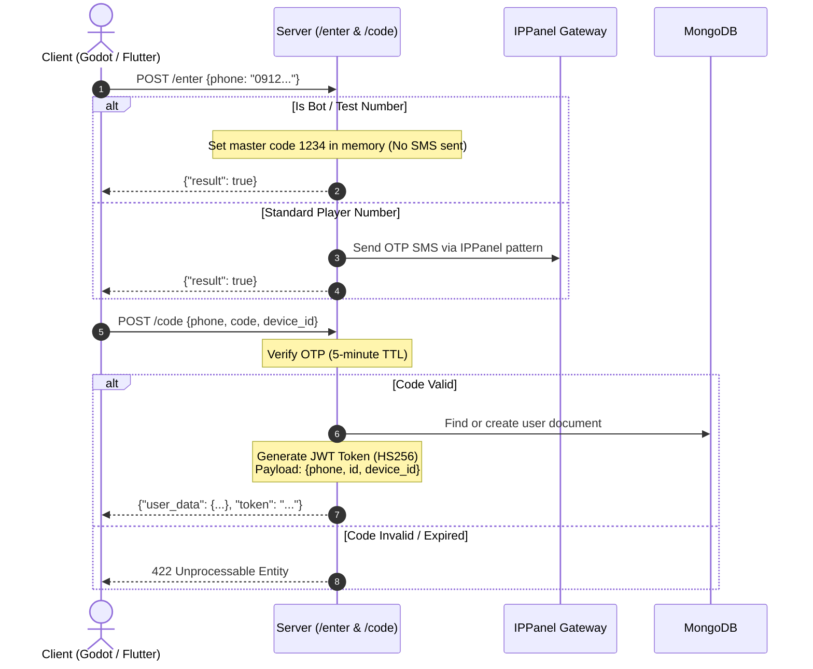

# Cafe Fekr — REST API Server (`kafehfekrserver`)

The **REST API and user authentication service** for **Cafe Fekr (کافه فکر)**. It manages user accounts, phone SMS OTP logins, referral codes, client app updates, economy/store transactions (CafeBazaar & Myket), global leaderboards, automated MongoDB backups, and administrative operations.

---

## 1. High-Level Summary

| Property | Value |
|---|---|
| **Primary Stack** | Python 3.12, `FastAPI`, `uvicorn`, `pymongo`, `passlib`, `python-jose` |
| **Default Port** | `5001` (`PORT=5001`, `HOST=0.0.0.0`) |
| **Protocol** | HTTP / HTTPS (REST API) |
| **Authentication** | JWT (HS256) with Device ID verification |
| **SMS Gateway** | IPPanel API (Persian OTP SMS provider) with bot account bypass |
| **Database** | MongoDB (`KafehFekrDB`) |
| **Companion Realtime Service** | `kafehfekrbackend` (Port `5000`) |

---

## 2. Directory Structure

```
kafehfekrserver/
├── main.py                     # Entry point: FastAPI app, router mounting, backup timer
├── Dockerfile                  # Container definition (Python 3.12-slim, non-root user)
├── requirements.txt            # Python dependencies (fastapi, pymongo, ippanel, etc.)
├── .dockerignore / .gitignore   # Ignored files
├── Backup/                     # Persistent local database backup storage
│
├── Commons/                    # Utility functions and shared constants
│   ├── app_consts.py           # Application-wide constants
│   └── static_functions.py     # Phone sanitization, bot phone recognition, password helpers
│
├── Entities/                   # Business logic and external service integrations
│   ├── Api_Services/           # Business handlers for auth, user queries, games admin
│   │   ├── auth.py             # User lookup, user creation, profile completion
│   │   ├── game.py             # Game history inspection and admin cleanup
│   │   └── user.py             # Profile data, coin balance, leaderboards, IAP validation
│   ├── Database/               # MongoDB collections and automated backup logic
│   │   ├── backup.py           # Hourly automated DB backup scheduler
│   │   ├── config_collection.py# System configuration (versioning, queue toggles)
│   │   ├── game_history_collection.py      # Individual round records
│   │   ├── game_play_history_collection.py # Match series records
│   │   ├── purchases_collection.py         # IAP transaction history
│   │   ├── user_history_collection.py      # Aggregated per-game user stats
│   │   ├── users_collection.py             # User profile, wallet, and session data
│   │   └── __init__.py         # Database connection and collection initialization
│   ├── Games/                  # Shared game types enum
│   │   └── game_types.py
│   ├── Network_Exeptions/      # Standardized HTTP error responses (401, 403, 422)
│   └── Security/               # Token creation, verification, and SMS OTP panel
│       ├── sms_panel.py        # OTP generation, delivery, memory store, expiration cleanup
│       └── __init__.py         # JWT token issuance and dependency extractors
│
└── Routers/                    # FastAPI route modules
    ├── admin_router.py         # Administrative endpoints (/admin/*)
    ├── auth_router.py          # Authentication and login endpoints (/enter, /code, /complete-data)
    ├── general_router.py       # Configuration, leaderboard, store, and reward endpoints
    └── user_router.py          # User profile, match history, and cosmetic update endpoints
```

---

## 3. API Endpoints Reference

### Authentication Endpoints (`Routers/auth_router.py`)

| Method | Endpoint | Auth | Request Body / Params | Description |
|---|---|---|---|---|
| `POST` | `/enter` | None | `phone` (Form) | Requests an SMS OTP. If phone is a registered test/bot phone, SMS sending is suppressed and code `1234` is staged automatically. |
| `POST` | `/code` | None | `phone`, `code`, `device_id` (Form) | Validates OTP. Returns existing user document or registers a new user, and returns a JWT access token. |
| `POST` | `/complete-data` | JWT | `username`, `rep_id` (optional, Form) | Completes new profile setup with a chosen username and optional referral ID (+30 coins bonus). |

### User Endpoints (`Routers/user_router.py`)

| Method | Endpoint | Auth | Request Body / Params | Description |
|---|---|---|---|---|
| `GET` | `/my-data` | JWT | Header: `Authorization: <token>` | Returns the authenticated user's profile document. |
| `GET` | `/my-history` | JWT | Header: `Authorization: <token>` | Returns user's win/loss/draw records grouped per board game. |
| `GET` | `/my-game-history` | JWT | Header: `Authorization: <token>` | Returns the user's last 50 matches with round-by-round results. |
| `GET` | `/user-data/{user_id}` | None | Path: `user_id` | Returns public profile data and aggregate history of a specific user. |
| `POST` | `/update-image` | JWT | `image` (int, Form) | Updates the player's active avatar icon. |
| `POST` | `/update-username` | JWT | `username` (Form) | Changes the player's display username. |
| `POST` | `/check_match_allow` | JWT | Query: `version` | Verifies whether the client version is permitted to join matches. |

### General & Store Endpoints (`Routers/general_router.py`)

| Method | Endpoint | Auth | Request Body / Params | Description |
|---|---|---|---|---|
| `GET` | `/health` | None | None | Service health check (`{"status": "ok", "service": "server"}`). |
| `GET` | `/config` | None | None | Returns app version constraints (`allowed_version`, `latest_version`) and queue status (`is_queue_open`). |
| `GET` | `/ranking-by-score` | None | None | Top 50 leaderboard ranked by competitive score (bots filtered out). |
| `GET` | `/ranking-by-win` | None | None | Top 50 leaderboard ranked by total match victories (bots filtered out). |
| `GET` | `/get-free-coin` | JWT | Header: `Authorization: <token>` | Daily / 8-hour free coin reward spinner (random coins). |
| `POST` | `/purchase` | JWT | `product_id`, `market_type`, `token` (Form) | Validates CafeBazaar or Myket in-app purchase receipts and credits coins. |

### Admin Endpoints (`Routers/admin_router.py`)

Protected via admin security token query parameter:

| Method | Endpoint | Params | Description |
|---|---|---|---|
| `GET` | `/admin/unfinished-games` | `token` | Lists matches that are currently marked as in-progress. |
| `GET` | `/admin/finished-games` | `token` | Lists completed match records. |
| `GET` | `/admin/delete-unfinished-games` | `token` | Cleans up orphaned or stuck active games from the database. |
| `GET` | `/admin/config-let-queue` | `token`, `value`, `hour`, `minute` | Schedules or toggles ranked queue availability. |
| `GET` | `/admin/change-version` | `token`, `allowed`, `latest` | Updates client app version enforcement rules. |
| `GET` | `/admin/users-count` | `token` | Returns total registered user count. |
| `GET` | `/admin/update-coin` | `token`, `user_id`, `value` | Adjusts coin balance for a specific user. |

---

## 4. Authentication & Security Flow



### Security Notes
- **Device Lock:** The JWT payload contains `device_id`. Requests validated by `get_current_user` verify that the request's device ID matches the user's recorded session.
- **Shared Secret:** The JWT signature key is shared between `kafehfekrserver` and `kafehfekrbackend` so tokens generated here are natively decoded on Socket.IO connections.

---

## 5. Database Architecture & Automated Backup

### MongoDB Collections (`KafehFekrDB`)

- **`users`**: Contains account profiles (`phone`, `username`, `coin`, `score`, `xp`, `image`, `device_id`, `open_game_id`, `open_pre_game_id`).
- **`user_history`**: Aggregated performance per board game (`game_type`, `wins`, `losses`, `draws`).
- **`game_play_history`**: Series-level match summaries (`game_id`, `players`, `series_scores`, `winner_id`, `reward`).
- **`game_history`**: Detailed round-level results within a match series.
- **`purchases`**: In-app purchase verification logs and product IDs.
- **`config`**: Global operational flags (`latest_version`, `allowed_version`, `is_queue_open`).

### Automated Backup System (`Entities/Database/backup.py`)
- Executes periodic backups using `mongodump` / JSON export every 60 minutes.
- Files are saved to the path configured by `BACKUP_DIR` (default `/app/Backups/`).
- Automatically prunes older backups to preserve disk space.

---

## 6. Configuration & Environment Variables

| Variable | Default | Purpose |
|---|---|---|
| `PORT` | `5001` | Listening port for the REST service |
| `HOST` | `0.0.0.0` | Host interface binding |
| `MONGO_URI` | `mongodb://localhost:27017/` | Connection string to MongoDB |
| `BACKUP_DIR` | `/app/Backups/` | Storage destination directory for MongoDB backups |

---

## 7. Running the Server

### Running with Docker Compose (Recommended)
From the project root:
```bash
docker compose up -d server
```

### Running Locally with Python
```bash
pip install -r requirements.txt
python main.py
```

### Health Check Endpoint
```bash
curl http://localhost:5001/health
# Response: {"status": "ok", "service": "server"}
```
